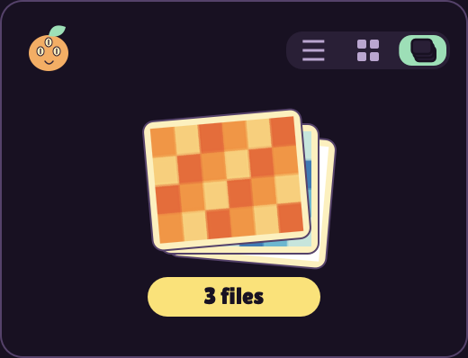

# Using Mandarine

## Drag. Tap. Done.

Start dragging a file, keep the mouse button held, then tap a modifier and drop onto a segment of the wheel.

| Default key | What opens | What you can do |
|---|---|---|
| **⇧ Shift** | Conversion wheel | Pick an output format. With multiple files, only compatible formats appear. |
| **⌘ Command** | Tools wheel | Crop, trim, compress, resize, edit metadata, and more. |
| **⌃ Control** | Actions wheel | Reveal in Finder, open, duplicate, copy files or paths, open Terminal, calculate SHA-256, or send to a shelf. |
| **⌥ Option** | Shelf | Collect files and carry them to another app or folder. |

**Using Control? Start dragging first, then press Control.** Control-click before a drag opens the macOS context menu.

Prefer clicking? Use the menu-bar icon → **Convert files…**, **Open tool for files…**, or **File actions…**.

Change a shortcut in **Settings → General** (wheels) or **Settings → Shelves**: click its key button and press Shift, Command, Control, or Option. **Esc** cancels. If a wheel and a shelf share a modifier, the wheel takes priority.

## A shelf for your next move

- Persistent shelves with **grid, list, and compact stack** views.
- Drag files in, then drag one file, a selection, or the whole stack out.
- Press **Space** for Quick Look; double-click to open a file.
- Dock a shelf to the left or right screen edge. It hides automatically and returns when you hover or drag over its tab.
- Optional **remove after a successful drag** removes shelf references, never the originals.
- Shelves, views, positions, and docking are restored when you reopen the app.

## Tools for everyday files

| Files | Tools |
|---|---|
| Images | Photo editing, background, crop, redact, resize, rotate, collage, create PDF |
| Video | Trim, crop, change speed and speed zones, join, split, save frames, redact |
| Audio | Trim, normalize, visualizer, channels, bleep |
| PDF | Merge, split, reorder and rotate pages |
| Mixed files | Compress and edit metadata where supported |

Conversion covers images, text documents, spreadsheets, audio, and video. Available actions depend on the selected files and installed components. Existing output files are not overwritten; Mandarine adds a number to the new filename.

**FFmpeg is included.** The DMG contains FFmpeg, ffprobe, and the codec libraries for Apple Silicon and Intel. There is no Homebrew setup and no separate download. Open **Settings → Compatibility** to see the included runtime and available encoders.

This software uses [FFmpeg](https://ffmpeg.org), distributed with GPL components. Its [corresponding source archive](https://github.com/AmedeoSaadMichel/mandarine/releases/download/v0.1.1/Mandarine-FFmpeg-9.0.2-sources.tar.gz), build recipe, and [license notices](../vendor/ffmpeg/NOTICE.md) are available alongside the installer.

